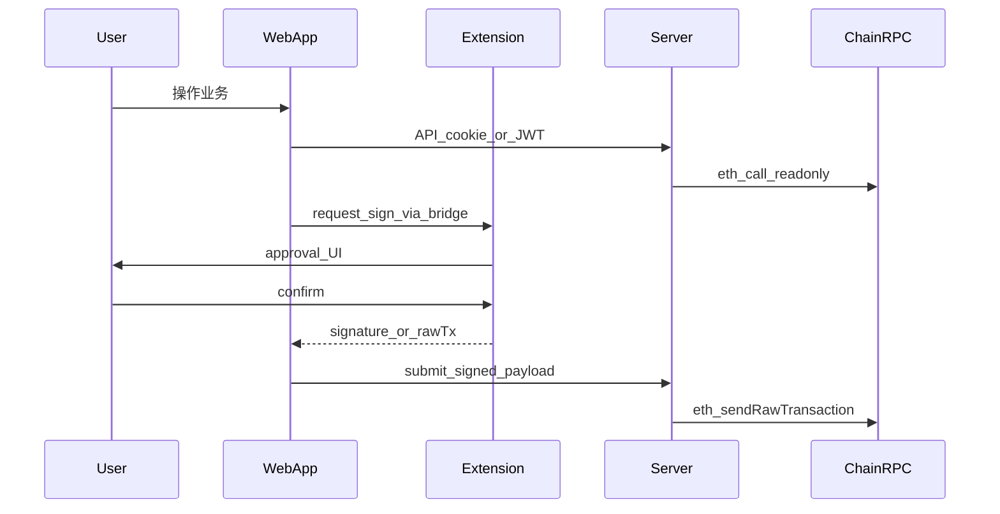
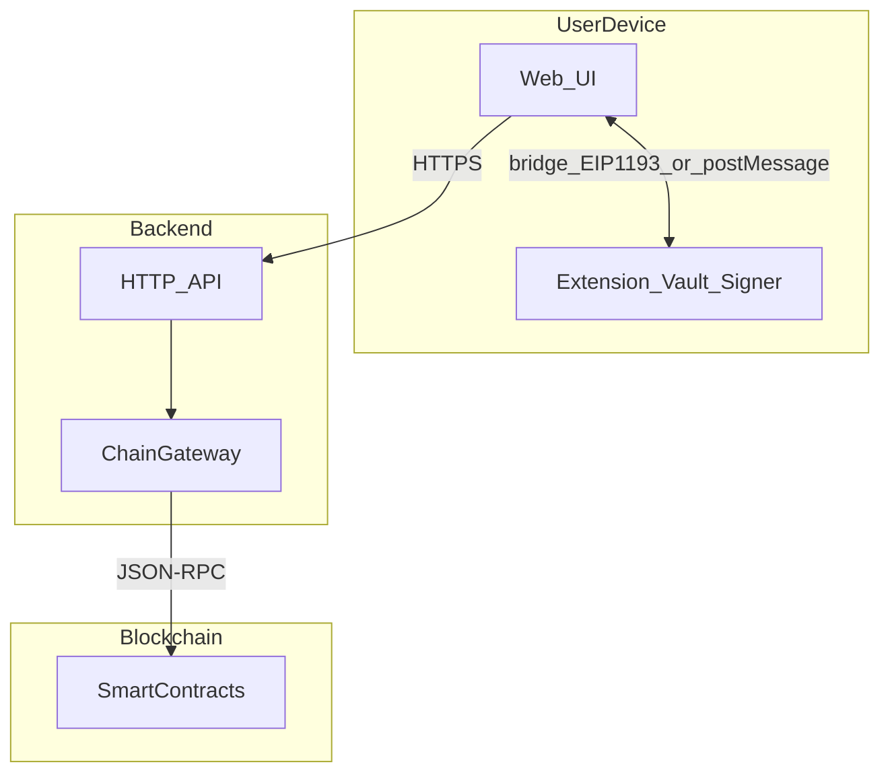

# 四端区块链项目 — 技术方案（长期文档）

## 0. 文档治理

- **文档性质**：本仓库四端系统的**架构与技术事实来源**（Architecture / Technical Specification）。
- **维护方式**：架构或边界变更时**同步更新本文**；重大变更通过 PR 说明影响面。
- **与代码的对应**：接口类型以 `packages/shared`（或等价路径）为准；本文描述语义与约束。
- **规范副本位置**：**本文档**（`docs/engineering/TECHNICAL-SOLUTION.md`）为 Git 中的规范正文；若使用 OpenCode / Cursor 等工具另有计划副本，以 PR 合并后的本文为准。
- **文档目录**：全库文档索引见 [docs/README.md](../README.md)。
- **产品文档**：整体与能力域 [PRODUCT-OVERVIEW.md](../product/PRODUCT-OVERVIEW.md)；索引与子项目分册
  [PRODUCT-FEATURES.md](../product/PRODUCT-FEATURES.md)（`prd-*.md`）。

### 修订记录（人工维护）

- **0.43** · 2026-10-19  
  AI 编码配置由 Cursor 迁移至 OpenCode：全仓规则 `.opencode/rules/*.md`（[opencode.json](../../opencode.json) 的 `instructions` 加载）、子项目规则为嵌套 `AGENTS.md`（`apps/extension/`、`packages/ui/`、`apps/extension/src/extension/utils/bridge/`）；`.cursorignore` 检索排除改为 `watcher.ignore`；[OPENCODE-SETUP.md](./opencode/OPENCODE-SETUP.md) 与各文档引用同步

- **0.44** · 2026-10-19  
  文档：产品 / 工程文档与代码现状同步——扩展 **TVM 账户管理**、**交易类 EIP-1193**（四类审批互斥与 `evmTxSubmitMode`）、**多链地址生成器**（EVM/TVM/BTC，CSV / JSON 导出）；Web 联调页（`wallet-demo` → `/wallet`、`/gateway`）；服务端 `batch-sender/build`、`status`、`meta`；`@plugin/shared` 契约与错误码清单；§4.1「当前代码基线」、§10 与 [extension.md](./extension.md)、[shared.md](./shared.md) 等同步

- **0.45** · 2026-10-19  
  服务端：**Tron 网关骨架**（数据源 **TronGrid**）——`GET /api/v1/tron/status`、`GET /api/v1/tron/explorer/account`、`POST /api/v1/tron/explorer/accounts`（按地址**串行**请求 + `SERVER_TRON_MIN_INTERVAL_MS` 节流，单次 ≤ 20 地址）；`SERVER_TRON_API_URL` / `SERVER_TRON_API_KEY`；`@plugin/shared` 新增 `http/tronExplorer`；§5.2、§5.4、§10 与 [server.md](./server.md)、[prd-server.md](../product/prd-server.md)、[shared.md](./shared.md) 同步

- **0.46** · 2026-10-20  
  Web：`/gateway` 联调页接入服务端 **Tron 网关**——单地址 / 批量查询 **TRX** 与 **TRC-20 原始数量**（每批 ≤ 20；表格预览上限 20 条，原始 JSON 保留全量）；批量中单地址失败按条目提示、不中断整批；[web.md](./web.md)、[prd-web.md](../product/prd-web.md)、§10 同步

- **0.47** · 2026-10-20  
  服务端：**BTC 网关骨架**（数据源 **Esplora**，默认 Blockstream 公共实例）——`GET /api/v1/btc/status`、`GET /api/v1/btc/explorer/address`、`POST /api/v1/btc/explorer/addresses`（按地址**串行** + `SERVER_BTC_MIN_INTERVAL_MS` 节流，单次 ≤ 20；主网地址校验 P2PKH / P2SH / SegWit v0 / Taproot）；`SERVER_BTC_API_URL`；`@plugin/shared` 新增 `http/btcExplorer`；§5.2、§5.4、§9、§10 与 [server.md](./server.md)、[prd-server.md](../product/prd-server.md)、[shared.md](./shared.md)、[prd-shared.md](../product/prd-shared.md) 同步

- **0.48** · 2026-10-20  
  Web：`/gateway` 增加 **BTC 面板**（数据源 **Esplora**）——单地址 / 批量地址余额（已确认 / 内存池净变化 / 交易数，单次 ≤ 20；批量按服务端串行）；页面按 **EVM / Tron / BTC** 拆分为 `src/components/gateway/*` 并改为分段切换（保留已查结果）；统一错误提示（从 JSON 错误体提取 message）与原始 JSON 折叠展示；修复 Web **UnoCSS 未扫描 `@plugin/ui`** 导致共享组件样式缺失；[web.md](./web.md)、[prd-web.md](../product/prd-web.md)、[ui.md](./ui.md)、§10 同步

- **0.49** · 2026-10-20  
  服务端：启动时按 **cwd `.env` → 仓库根 `.env`** 加载环境变量（Node `process.loadEnvFile`，已存在的进程变量优先）；EVM **原生余额**在配置 `SERVER_RPC_URL` 时优先走 RPC（`eth_chainId` 校验链一致），RPC 不可用再回退 Etherscan，响应新增 `source: "rpc" | "etherscan"`；Etherscan 网络失败后 60s 冷却，ERC-20 持仓返回 `etherscan_unreachable`；Web 显示 RPC 兜底来源与可读错误提示；§5.2、§5.4、[server.md](./server.md)、[prd-server.md](../product/prd-server.md)、[web.md](./web.md)、[server-evm-etherscan.md](../runbook/server-evm-etherscan.md) 同步

- **0.50** · 2026-10-20  
  Web：将 `/gateway` 页面名称由「服务端网关联调」改为 **多链余额查询**（EVM / Tron / BTC；路由保持不变），状态项「RPC 代理」改为「服务端 RPC」；文档术语统一为 **JSON-RPC 转发**，避免与网络代理混淆；[web.md](./web.md)、[prd-web.md](../product/prd-web.md)、[server.md](./server.md)、[prd-server.md](../product/prd-server.md)、[PRODUCT-OVERVIEW.md](../product/PRODUCT-OVERVIEW.md)、[evm-batch-balances.md](./evm-batch-balances.md)、[server-evm-etherscan.md](../runbook/server-evm-etherscan.md) 同步

- **0.51** · 2026-10-20  
  Web：多链余额查询页路由由 `/gateway` 改为 **`/balances`**（[`src/app/balances/page.tsx`](../../apps/web/src/app/balances/page.tsx)）；首页入口与文档链接同步；旧 `/gateway` 通过 [next.config.ts](../../apps/web/next.config.ts) 308 重定向到 `/balances`

- **0.52** · 2026-10-20  
  服务端 / Web：打通 **钱包登录 → 签名 → 服务端广播** MVP——新增 `POST /api/v1/auth/challenge`、`POST /api/v1/auth/verify`、`GET /api/v1/auth/me`、`POST /api/v1/auth/logout`（一次性 challenge 5 分钟、Bearer 会话 24 小时、进程内存存储）；新增 `POST /api/v1/tx/broadcast`（Bearer 会话 + raw tx 发送方 / chainId / RPC 链校验，当前仅 EVM）；Web 新增 `/account` 联调页（EIP-6963 / `window.ethereum` → challenge → `personal_sign` → 会话 → `eth_signTransaction` → 服务端广播）；`@plugin/shared` 补齐 auth / tx 请求与响应 schema；新增 [BACKLOG.md](./BACKLOG.md) 记录 P0–P4 待实现事项；§5.2、§5.4、§6、§10 与 [server.md](./server.md)、[web.md](./web.md)、[shared.md](./shared.md)、[prd-server.md](../product/prd-server.md)、[prd-web.md](../product/prd-web.md)、[PRODUCT-OVERVIEW.md](../product/PRODUCT-OVERVIEW.md) 同步

- **0.42** · 2026-04-23  
  扩展：DApp **bridge** 按功能分子目录（`siteConnect` / `personalSign` / `typedData` / `transaction`），入口仍 **`handleBridgeMessage.ts`** + **`constants.ts`**；桥接类型迁至 **`extension/types/bridge/`**（`~/types/bridge`）；[bridge/README.md](../../apps/extension/src/extension/utils/bridge/README.md)、[bridge/AGENTS.md](../../apps/extension/src/extension/utils/bridge/AGENTS.md)、[apps/extension/AGENTS.md](../../apps/extension/AGENTS.md) 同步
- **0.41** · 2026-04-23  
  扩展：**EIP-1193** 增补 **`eth_sign`**（转挂起路径同 `personal_sign`）、**`eth_signTransaction`**（仅返回已签名 RLP）、**`eth_sendRawTransaction`**（内置 RPC 广播已签名交易）；**`eth_sendTransaction`** 与全局 **`evmTxSubmitMode`**（侧栏「DApp 交易提交方式」）已在代码中完备；顶层 bridge **`signTransaction`** / **`sendTransaction`** 映射至上述 EIP 方法；§4.1 / §10、[extension.md](./extension.md)「EIP-1193 当前能力」同步
- **0.40** · 2026-04-20  
  扩展：链上 HD / 批量地址派生自 **`utils/vault`** 迁至 **`extension/web3/`**（`base/hd/derive`、`evm/addressGenerator`、`tvm/tvmAddressGenerator`、`btc/*`）；数量上限集中在 **`extension/constants/walletLimits.ts`**（`~/constants`）；**`vault`** 仅保留加密存储与解密签名（`record`、`tvmRecord`、`crypto`、`signing`）；TVM 持久化类型并入 **`types/vault.ts`**；[extension.md](./extension.md) 增补「vault 与 web3 目录边界」
- **0.39** · 2026-04-15  
  扩展：**`apps/extension/src` 下源码与类型文件**统一为 **camelCase** 命名（含 `contents/`、`tabs/`、`extension/**`）；`asserts` 目录更名为 **`assets`**；`extension-log` → **`extensionLog`**、`wallet-ui` 包路径 → **`walletUi`**；ESLint `unicorn/filename-case` 覆盖 `src/**/*`（见 `apps/extension/AGENTS.md`）；文档路径同步
- **0.38** · 2026-04-15  
  扩展：业务源码收拢至 **`src/extension/`**（`hooks/`、`ui/`、`types/`、`utils/`、`web3/`、`background/`）；Plasmo 入口仍在 **`src/`** 根；`tsconfig` 别名 `~lib/*`、`~/components/*`、`~/hooks/*`、`~/types`、`~web3`；[extension.md](./extension.md) 同步
- **0.37** · 2026-04-15  
  扩展：内容脚本 **`matches`** 从 `<all_urls>` 改为 **白名单**（[`contentScriptWhitelist.ts`](../../apps/extension/src/extension/utils/extension/contentScriptWhitelist.ts) 与 `manifest.web_accessible_resources` 同步）；[extension.md](./extension.md)「内容脚本与 DApp 桥接」同步
- **0.36** · 2026-04-08  
  `BalanceBatchReader`（[`evm/BalanceBatchReader.sol`](../../packages/contracts/src/evm/BalanceBatchReader.sol)）：**原子化** `getNativeBalances` / `getErc20Balances` / `getAllowances`；保留 `getBalances`；服务端 ABI 同步。[evm-batch-balances.md](./evm-batch-balances.md) §5
- **0.35** · 2026-04-08  
  **待办**：调研 **ERC-4337**（UserOperation、Bundler、智能账户）在**资金分散 / 归集**路径上的可行性；记入 §9
- **0.34** · 2026-04-07  
  服务端：开发态 **OpenAPI JSON**（`GET /documentation/json`）+ **Swagger UI**（`GET /documentation`），`NODE_ENV === 'production'` 不注册；可选 **`SERVER_SWAGGER=0`** 本地关闭。§5.4、[server.md](./server.md) 同步
- **0.33** · 2026-04-07  
  合约：新增 [`BatchCollector`](../../packages/contracts/src/evm/BatchCollector.sol)（ERC-20 多地址 `transferFrom` 归集至同一地址；原生 ETH 多 EOA 无签名批量拉取不可行，见合约 NatSpec）；[contracts.md](./contracts.md) 同步
- **0.32** · 2026-04-07  
  极简 API：撤销 `tokenBalanceFailureData` / `failureDataHex` / `failureReason`；`getBalances` 与 `POST /api/v1/evm/balance-reader/query` 的 `tokens[]` 仅保留 `ok` + `balanceRaw`。§5.2、[evm-batch-balances.md](./evm-batch-balances.md) §5
- **0.30** · 2026-04-07  
  合约：新增 [`BatchSender`](../../packages/contracts/src/evm/BatchSender.sol)（批量发送 ETH / ERC-20 `transferFrom`）；服务端新增 `POST /api/v1/evm/batch-sender/build`（构造 calldata + valueWei）；新增环境变量 `EVM_BATCH_SENDER_ADDRESSES_JSON`。§5.2、§5.4 同步
- **0.29** · 2026-04-06  
  扩展：**开发态调试日志**分组索引入 §4.1「开发态可观测性」；`@plugin/shared` `bridge/envelope` 与 [extension.md](./extension.md) 交叉引用技术方案
- **0.28** · 2026-04-06  
  `balance-reader` 请求：**代币地址 ≤10**；**仅原生**地址 **≤300**；**带代币**地址阶梯 **≤ min(200, ⌊1000/代币数⌋)**。合约 NatSpec 明确 `nativeBalances` 为 `address.balance`（链原生币 wei）。§5.2、[evm-batch-balances.md](./evm-batch-balances.md) §5
- **0.27** · 2026-04-06  
  合约：新增 [`BalanceBatchReader`](../../packages/contracts/src/evm/BalanceBatchReader.sol)（多地址原生 + 已知 ERC-20 一次 `eth_call`）；服务端 `POST /api/v1/evm/balance-reader/query` + `EVM_BALANCE_READER_ADDRESSES_JSON`；`GET /api/v1/evm/status` 增加 `balanceReaderConfigured`。§5.2、§5.4、[evm-batch-balances.md](./evm-batch-balances.md) §5 同步
- **0.26** · 2026-04-06  
  扩展：**EIP-712** `eth_signTypedData` / `eth_signTypedData_v3` / `eth_signTypedData_v4`（[`signTypedData`](../../apps/extension/src/tabs/signTypedData.tsx) 审批弹窗 + viem `signTypedData`）；与 **连接挂起**、**`personal_sign` 挂起** **三方互斥**。§4.1「当前代码基线」、§10、[extension.md](./extension.md) 同步
- **0.25** · 2026-04-06
  - **Tron DApp（插件、分期实现）**：链上编解码与 RPC 交互选型 **`tronweb`（npm `tronweb`）**；页面注入目标与 **TronLink / TIP-1193 风格 `request`** 互操作（**非** `window.ethereum`）。§1.3、§4.1、§9、§10 同步
  - 服务端：默认监听 `127.0.0.1`；`disableRequestLogging` + `onResponse` 单行 access；Pino 双写控制台与 `logs/server.log`；§5.4 增补 `SERVER_*` / `LOG_*`
- **0.24** · 2026-04-05  
  扩展：钱包 UI 状态**仅**读写 **`web3_wallet_ui_v1`**，**不**再读取或迁移旧键 `web3_wallet_demo_v1`
- **0.23** · 2026-04-05  
  扩展：移除**内置演示地址**（Anvil 默认地址等）；`chrome.storage.local` 钱包 UI 状态键为 **`web3_wallet_ui_v1`**；站点会话与无本地账户/已删账户对齐的**清理**；连接与 EIP-1193 须**至少一个加密账户**；侧栏监听 **`WALLET_UI_STATE_STORAGE_KEY`**
- **0.22** · 2026-04-05  
  `@plugin/shared`：新增 `evm/builtin-demo-chains`（`packages/shared/src/evm/builtin-demo-chains.ts`；后更名 `builtinEvmChains.ts`）（扩展内置链 ID/名称/主币符号，与 Web `wallet-demo` 共用）；扩展 EIP-1193 增加只读 **`eth_blockNumber`**；`wallet_*` / 只读 RPC 校验链 ID 改用 `isDemoWalletBuiltinEvmChainIdHex`
- **0.21** · 2026-04-05  
  工程文档与规则：[ui.md](./ui.md) 补充 `@plugin/ui` **组件清单**与开发约定；新增 [packages/ui/AGENTS.md](../../packages/ui/AGENTS.md)、[.opencode/rules/docs-maintenance.md](../../.opencode/rules/docs-maintenance.md)，约定 UI 包导出变更须**同任务**更新 `ui.md`、**不必**向用户确认是否写文档
- **0.20** · 2026-04-05  
  扩展：侧栏 **「已连接的网站」** 管理（列表、`revokeSiteSessionOrigin` / `revokeAllSiteAuthSessions`）；钱包 UI 状态存储键（后随 0.23 更名为 `WALLET_UI_STATE_STORAGE_KEY`）供侧栏监听 `chrome.storage.local`
- **0.19** · 2026-04-05  
  扩展：**EIP-1193** 补充 `wallet_switchEthereumChain` / `wallet_addEthereumChain`（仅 [内置公共 RPC 链表](../../apps/extension/src/extension/utils/walletUi/readonlyEvmRpc.ts)，自定义链未接）、`personal_sign`（[`signPersonal`](../../apps/extension/src/tabs/signPersonal.tsx) 弹窗 + 口令解密签名，见 [`vault/signing.ts`](../../apps/extension/src/extension/utils/vault/signing.ts)）、已连接站点的 **`eth_getBalance`**；站点连接挂起与签名挂起 **互斥**（`chrome.storage.session` 分键）；链 ID 持久化见 [`walletUiState`](../../apps/extension/src/extension/utils/walletUi/walletUiState.ts)
- **0.18** · 2026-04-05  
  扩展：初始化阶段**不保留存储/ API 兼容**——移除旧版单账户保险库迁移、`authorizedOrigins` 演示状态迁移、`LoadedVault` 与相关 `@deprecated` API；类型仅由 `~/types` 出口，`lib` 不再 re-export
- **0.17** · 2026-04-05  
  扩展与 `@plugin/ui`：**React 19**（与 Web 对齐）；`packages/ui` 的 `peerDependencies` 为 `^19.0.0`
- **0.16** · 2026-04-05  
  扩展：`apps/extension/tsconfig.json` 移除 **`paths` 中 `@types` / `@types/*` 别名**（与 npm `@types/*` 及 Parcel 冲突，会导致 `plasmo build` 无法解析 `.plasmo/static`）；类型引用统一 `~/types`；见 [extension-mv3.md](../runbook/extension-mv3.md)
- **0.15** · 2026-04-05  
  工具链：根 `package.json` 去掉 **`engines.node`**（避免 Parcel 在 monorepo 下误解析 Plasmo `.plasmo/static`）；**`engines.node` 迁至 `apps/extension/package.json`**（与 `targets.browsers` 同包）；说明见 [extension-mv3.md](../runbook/extension-mv3.md)
- **0.14** · 2026-04-05  
  扩展：inpage 以 Plasmo **`world: "MAIN"`** 内容脚本（[`inpageEvm.ts`](../../apps/extension/src/contents/inpageEvm.ts)）交付，隔离桥接仍在 [`allUrls.ts`](../../apps/extension/src/contents/allUrls.ts)；工程说明见 [extension.md](./extension.md)，排障见 [extension-mv3.md](../runbook/extension-mv3.md)
- **0.13** · 2026-04-05  
  扩展：inpage 脚本路径改为 `src/contents/inpageEvm.ts`；根与 `apps/extension` 的 `package.json` 增加 Parcel `targets.default.engines.browsers`；排障记入 [runbook · extension-mv3.md](../runbook/extension-mv3.md)（索引见 [issues-and-solutions.md](../runbook/issues-and-solutions.md)）
- **0.12** · 2026-04-05  
  文档：`docs/` 分层（product / engineering / runbook）；本文与 [§10](#10-附录现状基线仓库快照)、§4.1「当前代码基线」同步仓库快照；正文路径迁至 `docs/engineering/`
- **0.11** · 2026-04-05  
  服务端 EVM：Etherscan V2 **批量原生余额**（`POST .../native-balances`，最多 20 地址）与 **多地址 ERC-20 持仓**（`POST .../address-token-balances`，单地址 PRO 端点串行 + `ETHERSCAN_PRO_MIN_INTERVAL_MS`）；契约见 `packages/shared` `evmExplorer`
- **0.10** · 2026-04-04
  - 产品：插件**离线钱包**、**EIP-1193** 通用 DApp 调用、**多钱包档案**；[PRODUCT-FEATURES.md](../product/PRODUCT-FEATURES.md) 增 §A0；§1.1/§3.1/§4.1/§9 同步
  - 服务端 EVM：**托管 RPC 代理**（`POST /api/v1/evm/rpc`）+ **Etherscan API V2** 原生余额查询（`GET /api/v1/evm/explorer/native-balance`）；环境变量见 §5.4
- **0.9** · 2026-04-04  
  初始化 `apps/web`（Next 16 + viem + TanStack Query）、`apps/server`（Fastify 骨架）；合约包补充 README；根脚本与 CI 覆盖 web/server 构建
- **0.8** · 2026-04-04  
  产品扩展：批量地址查询、Tron、BTC（Web/服务端优先）；BTC 不纳入合约；插件 Tron/BTC 分期；§1.3/§4/§9 同步
- **0.7** · 2026-04-04  
  新增 [PRODUCT-FEATURES.md](../product/PRODUCT-FEATURES.md)，§0 增加产品文档索引
- **0.6** · 2026-04-04  
  浏览器插件栈在 §1.3 / §4.1 与 Web 端表格对齐固化（Plasmo、UnoCSS、bip39、工程化工具）
- **0.5** · 2026-04-04  
  服务端 / Web / 合约栈拍板：Fastify、Next.js App Router + viem + TanStack Query、Foundry
- **0.4** · 2026-04-04  
  合并 `documents/` 至 `docs/archive/`，新增 `docs/README.md`
- **0.3** · 2026-04-04  
  落地至仓库 `docs/TECHNICAL-SOLUTION.md`，链接改为相对路径
- **0.2** · —  
  拆分为正式技术方案结构，补充接口与安全细则
- **0.1** · —  
  初版四端计划与阶段划分

---

## 1. 背景与目标

### 1.1 业务目标

构建由四部分组成的区块链相关系统：

1. **浏览器插件**：作为**本地（离线）钱包扩展**，在终端内管理助记词/私钥、地址展示、消息与交易签名，作为**唯一持有解密后私钥**的组件；**不向服务端托管密钥**。
2. **Web 端**：基于插件提供的**公开信息**（如已连接地址、链 ID）做展示与业务流程；与服务端交互完成业务逻辑。
3. **服务端**：为 Web 提供业务 API；编排链上只读与**用户已签名交易**的广播；不托管用户私钥（默认模式）。
4. **智能合约**：链上逻辑与状态；供服务端与 Web（通过 ABI）解释与构造调用数据。

### 1.2 非目标（当前方案明确不做）

- 服务端代签用户资产相关交易（非托管前提下的「热钱包替用户转走资产」类能力）。
- Web 或服务端持久化明文私钥/助记词。
- 在未单独立项的情况下，将本方案扩展为合规托管、交易所级资金托管方案。
- **BTC 智能合约形态**：不在 `packages/contracts`（Foundry）范围内交付；BTC 需求通过 UTXO 查询/广播与 Web、服务端实现（见 [PRODUCT-OVERVIEW.md](../product/PRODUCT-OVERVIEW.md) §A6、§A8）。

### 1.3 技术前提

- **链类型与产品范围**
  - **EVM** 为插件与合约主线基线（`viem`、BIP44 `m/44'/60'/...`）。
  - 产品扩展要求 **Tron** 与 **BTC** 相关能力：**Web 与服务端**优先（含**批量地址信息查询**等，见 [PRODUCT-FEATURES.md](../product/PRODUCT-FEATURES.md)）。
  - **智能合约**仅面向可编程链（当前为 **EVM**；**Tron 合约**若需要另开 ADR），**不包含 BTC**。
  - **浏览器插件**对 **Tron / BTC** 的钱包与签名能力**后续阶段**落地，不与 EVM MVP 强绑定。
  - **Tron DApp 钱包形态（插件）**：链上构造、签名与广播相关能力以 **`tronweb`** 为**唯一指定** TypeScript/JavaScript SDK；向页面暴露 **`tronLink.request` 等生态约定注入面**（与 TronLink、TIP-1193 风格 provider 互操作为目标），与 EVM 的 EIP-1193（`window.ethereum`）**分轨**实现。
- **浏览器插件栈（已定）**：**Plasmo**（**Chrome Manifest V3**）、**React 19**、**TypeScript**、**UnoCSS**、**viem**、**bip39**；代码风格与质量 **ESLint**、**Prettier**、**stylelint**（CSS）；路径别名 `~` → `src/`。实现以 [apps/extension/package.json](../../apps/extension/package.json) 为准，重大升级在 §0 留痕。
- **Web 栈（已定）**：**Next.js（App Router）+ TypeScript + React**；EVM 侧链交互以 **viem** 为主；**Tron / BTC** 数据以调用**服务端 API**为主，避免在浏览器分散持有各链密钥与 RPC 配置。服务端状态与缓存 **TanStack Query**。
- **服务端栈（已定）**：**Node.js + TypeScript + Fastify**（HTTP API、**多链 ChainGateway**、**批量地址查询 API**）；需要持久化时 **Drizzle** 或 **Prisma** 二选一，首版可无 DB。
- **智能合约栈（已定）**：**Foundry**；Solidity **0.8.x**（具体补丁版本在 `foundry.toml` 锁死）；**范围不含 BTC**。
- **仓库与包管理（已定）**：**pnpm** monorepo（见 §7）；Node **LTS 主版本**（如 22.x）在初始化 `apps/server` 时写入 `package.json` 的 `engines`。

---

## 2. 系统上下文与参与者

| 参与者     | 说明                                            |
| ---------- | ----------------------------------------------- |
| 终端用户   | 安装插件、访问 Web、在插件 UI 中确认签名        |
| 浏览器插件 | Vault、签名、与 Web / content script 通信       |
| Web 应用   | 展示、业务操作入口、调用服务端 API              |
| 服务端     | 会话、业务数据、链 RPC 网关、（可选）索引与任务 |
| 区块链节点 | JSON-RPC 或供应商 API                           |
| 智能合约   | 部署在目标链上的业务合约                        |

---

## 3. 逻辑架构

### 3.1 信任边界（必须遵守）

- **私钥与助记词**：仅存在于插件进程内存（解密后）及加密形态（存储中）；**不得**经 Web `postMessage`、HTTP、日志明文传出。**签名在本地完成**，插件即**离线钱包**能力载体（网络仅用于广播已签名交易或读取链数据，不经手明文私钥）。
- **Web 可信源**：仅与**白名单 origin** 的页面或自有 Web 通信；content script 注入须防止任意页面冒充（来源校验、challenge）。
- **服务端**：验证会话与业务权限；可存储**地址**、**已签名交易哈希**、业务实体；不存储用户私钥。

### 3.2 数据流（概览）

### 3.3 组件关系图

---

## 4. 四端职责与技术方案

### 4.1 浏览器插件（Extension）

#### 技术栈

**Plasmo**（MV3）、**React 19**、**TypeScript**、**UnoCSS**、**viem**、**bip39**；**ESLint** / **Prettier** / **stylelint**

#### 职责

密钥派生/导入、加密存储、**多钱包档案**切换、账户切换、签名（消息 / EIP-712 / 交易）、连接授权

#### 产品定位

**离线扩展钱包**：密钥与签名在本地；不托管密钥到服务端。

#### DApp 兼容

**EVM**：**EIP-1193** provider（如 `window.ethereum`），JSON-RPC 风格；与自有域 **postMessage** 可并存。**Tron**（分期）：以 **`tronweb`** 为底层；注入目标对齐 **TronLink / TIP-1193 风格 `request`**（如 `tron_requestAccounts` 等），**不**复用 `window.ethereum`。

#### 运行时

MV3：`background`（service worker）为消息枢纽；popup / side panel / tab / content script 仅通过统一 messaging

#### 存储

`chrome.storage.local` 存加密 vault；支持**多钱包档案**（分 vault 或等价隔离）；可选密码派生密钥（PBKDF2/Argon2 等选型在实现阶段 ADR）

#### 密码学与链

**EVM**：`viem`（`mnemonicToAccount`、`signMessage`、`signTypedData`、交易序列化与签名）。**Tron**（分期）：**`tronweb`** + Tron HTTP API（FullNode / TronGrid 等）；地址派生 BIP44 **`m/44'/195'/...`** 在 **`extension/web3`** 实现，与 **`vault`** 持久化解耦。

#### 多链（分期）

当前实现以 **EVM** 为主。**Tron**：DApp 与链交互库**已定 `tronweb`**，实现分期（产品见 [PRODUCT-OVERVIEW.md](../product/PRODUCT-OVERVIEW.md) §A8）。**BTC**：插件内密钥与签名**后续阶段**再评估。

#### 与 Web 集成

**路径 A（EVM）**：content script 注入 `window.ethereum`（EIP-1193）；**路径 A′（Tron，分期）**：MAIN 世界注入 **`tronLink` / `tronWeb` 生态约定**（与 Tron DApp 互操作）。**路径 B**：自有域使用 `postMessage` + 扩展 ID 校验 + SDK；可并存

#### 当前代码基线

已有 **MV3 [background](../../apps/extension/src/background.ts)**（侧载 [serviceWorker.ts](../../apps/extension/src/extension/background/serviceWorker.ts)）；**隔离世界** [allUrls.ts](../../apps/extension/src/contents/allUrls.ts) 与 **MAIN 世界** [inpageEvm.ts](../../apps/extension/src/contents/inpageEvm.ts)（EIP-1193 / EIP-6963）。

**bridge**：[handleBridgeMessage.ts](../../apps/extension/src/extension/utils/bridge/handleBridgeMessage.ts)。

**vault**：[utils/vault/](../../apps/extension/src/extension/utils/vault/)（加密账户包与 [signing.ts](../../apps/extension/src/extension/utils/vault/signing.ts)）。

**web3**：[extension/web3/](../../apps/extension/src/extension/web3/)（HD 与 EVM/TVM/BTC 批量地址派生）。

**constants**：[extension/constants/](../../apps/extension/src/extension/constants/)（`~/constants`，批量上限等无依赖常量）。

**钱包 UI / 只读 RPC**：[walletUiState.ts](../../apps/extension/src/extension/utils/walletUi/walletUiState.ts)、[readonlyEvmRpc.ts](../../apps/extension/src/extension/utils/walletUi/readonlyEvmRpc.ts)。

**侧栏**：[walletPanel.tsx](../../apps/extension/src/extension/ui/wallet/walletPanel.tsx)（含 [connectedSitesSection.tsx](../../apps/extension/src/extension/ui/wallet/sections/connectedSitesSection.tsx) 已连接网站列表与断开；全局设置 [globalSettingsView.tsx](../../apps/extension/src/extension/ui/wallet/views/globalSettingsView.tsx)：默认账户 / 交易提交方式 / 站点授权策略）。

**审批与账户 Tab**：[siteConnect](../../apps/extension/src/tabs/siteConnect.tsx)、[signPersonal](../../apps/extension/src/tabs/signPersonal.tsx)、[signTypedData](../../apps/extension/src/tabs/signTypedData.tsx)、[signSendTransaction](../../apps/extension/src/tabs/signSendTransaction.tsx)；账户管理 [evmAccounts](../../apps/extension/src/tabs/evmAccounts.tsx)、[tvmAccounts](../../apps/extension/src/tabs/tvmAccounts.tsx)（TVM 仅生成 / 导入 / 列表，不签名）；[generateAccounts](../../apps/extension/src/tabs/generateAccounts.tsx)（EVM / TVM / BTC 批量派生与导出）。

**EIP-1193（EVM）**：只读与账户类——`eth_chainId`、`net_version`、`eth_accounts`、`eth_requestAccounts`、`wallet_switchEthereumChain` / `wallet_addEthereumChain`（内置链）、`eth_getBalance`、`eth_blockNumber`、`eth_sendRawTransaction`。

**消息 / 结构化签名**：**`personal_sign`**、**`eth_sign`**（内部等同 `personal_sign` 挂起路径）、**`eth_signTypedData` / `eth_signTypedData_v3` / `eth_signTypedData_v4`**（EIP-712）。

**交易**：**`eth_sendTransaction`**（口令弹窗；返回哈希或已签名 RLP 由持久化 **`evmTxSubmitMode`** 决定）、**`eth_signTransaction`**（口令弹窗；固定仅返回已签名 RLP）。

**挂起互斥**：连接、`personal_sign`/`eth_sign`、EIP-712、`eth_sendTransaction`/`eth_signTransaction` **四者不得同时挂起**（见 [bridge/constants](../../apps/extension/src/extension/utils/bridge/constants.ts)）。

**仍未实现或受限**：**多钱包档案**、**自定义 RPC 链**、生产级**会话解锁**；**Tron DApp**（`tronweb` + TronLink 风格注入）仅技术方案已定，**代码未接**；**BTC** 仅地址派生工具（钱包 / 签名未实现）；站点侧尚无搜索 / 分组等增强。明细表见 [extension.md](./extension.md)「EIP-1193 当前能力」。

#### 开发态可观测性（扩展日志索引）

实现入口：[extensionLog.ts](../../apps/extension/src/extension/utils/extensionLog.ts)（`extLogDebug` / `extLogInfo` / `extLogWarn`）。**生产构建**（`NODE_ENV === 'production'`）下静默。

安全边界（禁止记录口令、助记词、私钥、待签原文等）与 [web3-security.md](../../.opencode/rules/web3-security.md)、[extension.md](./extension.md) 一致。

| 控制台上下文                     | 如何打开                                                  |
| -------------------------------- | --------------------------------------------------------- |
| **Service Worker**（background） | `chrome://extensions` → 扩展 → **Service worker**         |
| **隔离内容脚本**                 | 页面 **DevTools** → 选扩展 **content script** 上下文      |
| **MAIN 世界 inpage**             | 页面 DevTools → 扩展 **inpage** / 对应 frame              |
| **扩展页 UI**（侧栏、popup 等）  | 扩展页 **右键检查** 或 `chrome-extension://…` 的 DevTools |

**Service Worker 典型前缀（节选）**（分号分隔便于检索）：

`bridge_in` / `bridge_out` / `bridge_dispatch` / `bridge_throw`；`bridge_handler_reject`；`site_connect_blocked` / `site_connect_deferred`；`personal_sign_blocked` / `typed_data_sign_blocked`；`personal_sign_deferred` / `typed_data_sign_deferred`；`send_transaction_deferred`（含 `pendingTxRpcMethod`）；

`runtime_*`（批准/拒绝挂起）；`sw_lifecycle`；`tab_sessions_revoked`；`side_panel_open` / `side_panel_open_failed`；`connect_approval_address`；`readonly_rpc_error`；`site_session`；`wallet_chain_set`；

`vault_bundle_coerce`；`wallet_ui_pruned`；`resolve_*` / `reject_*`（含 `tab_send_failed`）；`approval_popup_*` / `approval_popup_create_failed`

**隔离内容脚本**：`cs_bridge_*`（[`allUrls.ts`](../../apps/extension/src/contents/allUrls.ts)）

**MAIN 世界 inpage**：`inpage_bridge_*`（[`inpageEvm.ts`](../../apps/extension/src/contents/inpageEvm.ts)）

**扩展页 UI**：`panel_approve_site_connect` / `panel_reject_site_connect`；`panel_action`；`tab_*`（独立审批窗口）

完整字段与策略说明以源码注释及 [extension.md](./extension.md) 开发日志小节为准；上表与列表仅作**按上下文检索**的索引。

### 4.2 Web 端

| 维度           | 方案要点                                                                                                                                                                        |
| -------------- | ------------------------------------------------------------------------------------------------------------------------------------------------------------------------------- |
| 技术栈         | **Next.js（App Router）**、TypeScript、React、**viem**、**TanStack Query**                                                                                                      |
| 职责           | 展示插件提供的地址/链；拉取服务端业务与链上解释数据；发起需签名的操作并收集签名结果上送                                                                                         |
| 多链与批量查询 | 支持 **EVM / Tron / BTC** 相关视图（具体以服务端能力为准）；**批量地址信息查询**由 Web 提交列表、展示聚合结果（见 [PRODUCT-OVERVIEW.md](../product/PRODUCT-OVERVIEW.md) §A4）。 |
| 与插件         | 检测扩展、请求连接、订阅账户/链变更、调用签名方法（封装在 bridge SDK 中）                                                                                                       |
| 与服务端       | 以 **REST**（Fastify）为主；鉴权推荐 **SIWE 或自定义 challenge + `personal_sign`** 绑定地址后会话                                                                               |
| 状态           | **TanStack Query** 处理服务端状态；链上只读优先经服务端代理以降低 CORS 与密钥暴露                                                                                               |

### 4.3 服务端

| 维度   | 方案要点                                                                                                                                                                                                                            |
| ------ | ----------------------------------------------------------------------------------------------------------------------------------------------------------------------------------------------------------------------------------- |
| 技术栈 | **Node.js + TypeScript + Fastify**；需要持久化时 **Drizzle** 或 **Prisma** 二选一（首版可无 DB）                                                                                                                                    |
| 职责   | 用户会话、业务 CRUD、链上只读聚合、接收**已签名**交易并广播、（可选）监听事件更新业务状态                                                                                                                                           |
| 链访问 | 按 **chainFamily**（如 `evm` / `tron` / `btc`）路由：EVM 使用 JSON-RPC；**Tron** 使用 HTTP API（如 TronGrid）；**BTC** 使用 Esplora、自建节点等。实现 **ChainGateway** 扩展；提供**批量地址查询** API（限流、缓存、单次条数上限）。 |
| 安全   | 速率限制、认证、审计日志；**禁止**日志打印完整签名载荷中的敏感组合（按合规要求裁剪）                                                                                                                                                |
| 可选   | 消息队列 + worker 做确认数等待；索引器同步合约事件                                                                                                                                                                                  |

### 4.4 智能合约

| 维度   | 方案要点                                                                                                                       |
| ------ | ------------------------------------------------------------------------------------------------------------------------------ |
| 技术栈 | **Foundry**（`forge` / `anvil` / `cast`）；Solidity **0.8.x**，编译器补丁版本在 `foundry.toml` 锁死                            |
| 职责   | 链上状态机与权限（owner、role、pause 等按业务定）                                                                              |
| 工程化 | 单包 `packages/contracts`：源码、测试、部署脚本；构建产出 **ABI + 部署地址表**（按 `chainId`）                                 |
| 范围   | **可编程链**（当前以 **EVM** 为主）；**BTC 不纳入**；**Tron** 若上合约需单独 ADR 与目录/配置策略。                             |
| 消费方 | Web 用 ABI 编码调用数据（或由服务端返回 calldata）；插件侧主要关注交易字段与人类可读解析（可复用 `viem` `decodeFunctionData`） |

---

## 5. 接口与契约（概要规格）

以下为**语义级**约定；具体 TypeScript 类型放在 `packages/shared`。

### 5.1 扩展内部 / 扩展 ↔ Web（Bridge）

建议统一信封（示例字段名）：

- `id`：请求关联 ID
- `method`：如 `connect` | `disconnect` | `eth_accounts` | `signMessage` | `signTypedData` | `signTransaction` | `sendTransaction`（若走 EIP-1193）
- `params`：方法参数（链 ID、raw 交易、typed data 等）
- `error`：`code` + `message`（与 EIP-1193 错误风格对齐便于 Web 处理）

**约束**：响应中不得包含 `privateKey`、`mnemonic`；仅 `address`、`signature`、`rawTransaction` 等。

**可观测性（扩展）**：开发态 `extLog*` 消息前缀与控制台上下文对照见 **§4.1「开发态可观测性（扩展日志索引）」**；实现入口 `apps/extension/src/extension/utils/extensionLog.ts`。

### 5.2 Web ↔ 服务端（HTTP）

以下为资源语义；已实现路径以 `/api/v1/*` 为准，规划项单独标注。

- **Auth（MVP 已实现）**：
  - `POST /api/v1/auth/challenge` → 服务端生成一次性 SIWE 风格消息（5 分钟过期）。
  - `POST /api/v1/auth/verify` → 提交地址 + `personal_sign` 签名 → 签发 **Bearer 会话**（24 小时）。
  - `GET /api/v1/auth/me` → 当前会话地址 / chainId / 过期时间。
  - `POST /api/v1/auth/logout` → 注销 Bearer 会话（幂等）。
  - 当前 challenge / session 存于**进程内存**，服务重启失效；Web 用 `sessionStorage` 保存 Bearer token。生产化需持久化、限流、HttpOnly Cookie / CSRF 与 CORS 收紧（见 [BACKLOG.md](./BACKLOG.md) P4-5）。
- **交易广播（MVP 已实现，EVM only）**：
  - `POST /api/v1/tx/broadcast` → JSON `{ chainId, signedTransaction }`；要求 Bearer 会话；校验 raw tx 的 `chainId`、签名者地址与 `SERVER_RPC_URL` 的 `eth_chainId`，再调用 `eth_sendRawTransaction`。
- **批量地址查询（规划）**：`POST /addresses/batch`（或等价路径）→ 批量查询多地址链上摘要（EVM / Tron / BTC 等，字段与限额见 PRD）。
- 业务资源：`/api/v1/...` 按领域再分。
- **EVM 链网关（已实现骨架）**：
  - `POST /api/v1/evm/rpc`：向 `SERVER_RPC_URL` 转发 JSON-RPC（**方法白名单**，含常见只读与 `eth_sendRawTransaction`；批量请求最多 10 条）。
  - `GET /api/v1/evm/explorer/native-balance?address=&chainId=`：单地址原生币余额。配置 `SERVER_RPC_URL` 时**优先**经 RPC `eth_getBalance`（先校验 `eth_chainId` 与请求一致）；否则 / RPC 不可用时回退 **Etherscan V2**（[balance](https://docs.etherscan.io/api-reference/endpoint/balance)）。响应含 `source: "rpc" | "etherscan"`。
  - `POST /api/v1/evm/explorer/native-balances`：JSON `{ chainId, addresses }`，最多 **20** 个地址；数据源选择同上（RPC 批量走单次 JSON-RPC batch，Etherscan 走逗号分隔 `balance`），响应含 `source`。
  - `POST /api/v1/evm/explorer/address-token-balances`：JSON `{ chainId, addresses, page?, offset? }`，每地址调用 [addresstokenbalance](https://docs.etherscan.io/api-reference/endpoint/addresstokenbalance)（**PRO**、供应商侧约 **2 次/秒**）；服务端**串行**并可用 `ETHERSCAN_PRO_MIN_INTERVAL_MS` 节流。该能力**仅依赖 Etherscan**；网络不可达时返回 `etherscan_unreachable`，并在 60s 内短路重试。
  - `POST /api/v1/evm/balance-reader/query`：JSON `{ chainId, addresses, tokenAddresses? }`，经 **`SERVER_RPC_URL`** 对已部署的 **`BalanceBatchReader.getBalances`** 做 **`eth_call`**。
    - 返回 **`nativeBalances`**：各地址 **`address.balance`**（链原生币 wei）。
    - **`tokenAddresses`**：ERC-20 列表（默认 `[]` 则仅返回原生）；代币格仅 **`ok` + `balanceRaw`**（失败时 `ok=false` 且 `balanceRaw` 为 `0`）。
    - Reader 地址：**`EVM_BALANCE_READER_ADDRESSES_JSON`**；**限额**：代币 **≤10**；仅原生时地址 **≤300**；带代币时地址 **≤ min(200, ⌊1000/代币数⌋)**（见 `@plugin/shared` `evmBalanceReaderQueryRequestSchema` 与常量）。
    - 合约另提供原子化 **`getNativeBalances` / `getErc20Balances` / `getAllowances(token,spender,holders)`**（当前 HTTP 未封装 allowance，可自行 `eth_call`）。
  - `POST /api/v1/evm/batch-sender/build`：JSON（`kind: 'eth' | 'erc20_transferFrom'`），返回 `{ to, data, valueWei }` 供扩展/前端签名并广播（非托管）。合约地址由 `EVM_BATCH_SENDER_ADDRESSES_JSON` 提供；ERC-20 模式下用户需先对合约 `approve` 足够额度，随后调用 `BatchSender.batchSendErc20TransferFrom`。
  - **链上**：[`BatchCollector`](../../packages/contracts/src/evm/BatchCollector.sol) 提供 **`collectErc20Batch`**（多源地址 `approve` 后归集 ERC-20 至同一 `to`）；**原生 ETH** 无法在一笔调用中从多个 EOA 无签名批量「拉取」，与 ERC-20 `transferFrom` 不同（见合约 NatSpec）。当前仓库**未**提供对应 HTTP `build` 路由，可按 `batch-sender` 方式扩展。
  - `GET /api/v1/evm/status`：是否已配置 RPC / Etherscan / **至少一条合法 balance reader 映射**（布尔字段 `balanceReaderConfigured`，不含密钥与具体地址）。
  - **Tron 链网关（已实现骨架，数据源 TronGrid）**：
    - `GET /api/v1/tron/explorer/account?address=T...`：单地址 **TRX 余额（sun）** 与 **TRC-20 持仓（原始数量）**（[TronGrid accounts](https://developers.tron.network/reference/getaccount)）；服务端校验 **base58check** 地址。
    - `POST /api/v1/tron/explorer/accounts`：JSON `{ addresses }`，最多 **20** 个地址；服务端**按地址串行**调用 TronGrid 并以 `SERVER_TRON_MIN_INTERVAL_MS`（默认 250）节流；单地址上游失败（如公共额度 429）以条目内 `error` 返回（不中断整批）。
    - `GET /api/v1/tron/status`：Tron API Key 是否配置与批量串行间隔（`apiKeyConfigured`、`minIntervalMs`；不含密钥）。
  - **BTC 链网关（已实现骨架，数据源 Esplora）**：
    - `GET /api/v1/btc/explorer/address?address=...`：单地址**已确认余额**（sat）、**内存池净变化**与已确认交易数（[Esplora API](https://github.com/Blockstream/esplora/blob/master/API.md)）；服务端校验**比特币主网地址**（P2PKH / P2SH / SegWit v0 / Taproot）。
    - `POST /api/v1/btc/explorer/addresses`：JSON `{ addresses }`，最多 **20** 个地址；服务端**按地址串行**调用 Esplora 并以 `SERVER_BTC_MIN_INTERVAL_MS`（默认 250）节流；单地址上游失败以条目内 `error` 返回（不中断整批）。
    - `GET /api/v1/btc/status`：自定义端点是否配置与批量串行间隔（`apiUrlConfigured`、`minIntervalMs`）。

### 5.3 服务端 ↔ 链

- **EVM**：标准 **JSON-RPC**（托管节点 URL，经服务端转发）；索引类查询（如按地址聚合、多链统一 key）可接 **[Etherscan API V2](https://docs.etherscan.io/introduction)** 等浏览器 API，与 RPC 互补。
- **Tron / BTC**：各用官方或托管 **HTTP API**（如 TronGrid、Esplora）；不引入额外专有协议除非有运维需求。

### 5.4 配置项（环境变量示例）

| 变量                                          | 用途                                                                                                                                                                               |
| --------------------------------------------- | ---------------------------------------------------------------------------------------------------------------------------------------------------------------------------------- |
| `NEXT_PUBLIC_CHAIN_ID`                        | Web 默认链                                                                                                                                                                         |
| `NEXT_PUBLIC_RPC_URL`                         | （可选）浏览器侧只读；慎用，多数只读走服务端                                                                                                                                       |
| `SERVER_PORT` / `SERVER_HOST`                 | Fastify 监听；默认 `8787`、`127.0.0.1`（仅本机）；需局域网监听时用 `0.0.0.0`                                                                                                       |
| `SERVER_SWAGGER`                              | （可选）`0` / `false` 时，**即使非 production** 也不注册 OpenAPI / Swagger UI；默认在非 production 启用 `GET /documentation`、`GET /documentation/json`                            |
| `LOG_FILE` / `LOG_TO_FILE`                    | 服务端文件日志（每行 JSON）；默认相对运行目录 `logs/server.log`；`LOG_TO_FILE=0` 关闭                                                                                              |
| `LOG_LEVEL` / `LOG_PRETTY`                    | Pino 级别；`LOG_PRETTY` 控制开发态控制台是否 pino-pretty                                                                                                                           |
| `SERVER_RPC_URL`                              | 服务端 EVM JSON-RPC（`POST /api/v1/evm/rpc` 上游）；配置后也作为**原生余额**首选数据源（`eth_chainId` 必须与请求链一致，否则回退 Etherscan）                                       |
| `ETHERSCAN_API_KEY`                           | [Etherscan API V2](https://docs.etherscan.io/introduction) 密钥（勿提交仓库；仅服务端使用）                                                                                        |
| `ETHERSCAN_API_URL`                           | （可选）V2 API 根地址，默认 `https://api.etherscan.io/v2/api`                                                                                                                      |
| `ETHERSCAN_PRO_MIN_INTERVAL_MS`               | （可选）多地址 `addresstokenbalance` 串行间隔（毫秒），默认 `550`                                                                                                                  |
| `EVM_BALANCE_READER_ADDRESSES_JSON`           | （可选）`BalanceBatchReader` 部署地址，JSON：`{"1":"0x...","11155111":"0x..."}`（键为十进制 `chainId`）；与 `POST /api/v1/evm/balance-reader/query` 及 `SERVER_RPC_URL` 目标链一致 |
| `EVM_BATCH_SENDER_ADDRESSES_JSON`             | （可选）`BatchSender` 部署地址，JSON：`{"1":"0x...","11155111":"0x..."}`（键为十进制 `chainId`）；与 `POST /api/v1/evm/batch-sender/build` 的 `chainId` 一致                       |
| `SERVER_TRON_API_URL` / `SERVER_TRON_API_KEY` | [TronGrid](https://developers.tron.network/) 根地址（默认 `https://api.trongrid.io`）与 API Key（勿提交仓库；仅服务端使用）                                                        |
| `SERVER_TRON_MIN_INTERVAL_MS`                 | （可选）Tron 批量地址查询的串行间隔（毫秒），默认 `250`                                                                                                                            |
| `SERVER_BTC_API_URL`                          | （可选）[Esplora](https://github.com/Blockstream/esplora/blob/master/API.md) API 根地址，默认 `https://blockstream.info/api`（只读；无需 Key）                                     |
| `SERVER_BTC_MIN_INTERVAL_MS`                  | （可选）BTC 批量地址查询的串行间隔（毫秒），默认 `250`                                                                                                                             |
| `CONTRACT_ADDRESSES_JSON` 或分键              | 各 `chainId` 下合约地址                                                                                                                                                            |
| `SESSION_SECRET` / OAuth 等                   | **预留**：持久化 / Cookie 会话或第三方登录时使用；当前 Bearer token 为进程内随机 token，不读取该变量                                                                               |

服务端启动时自动加载 `.env`：优先当前工作目录，其次仓库根（`pnpm dev:server` 的 cwd 为 `apps/server`）；使用 Node 内置 `process.loadEnvFile`，**已存在的进程环境变量优先**，不覆盖 CI / 生产注入。`.env` 勿提交仓库。

---

## 6. 安全模型摘要

| 威胁                | 缓解                                                             |
| ------------------- | ---------------------------------------------------------------- |
| 恶意网页冒充 bridge | origin 白名单、扩展 ID 校验、challenge-nonce                     |
| XSS 窃取会话        | httpOnly cookie、CSP、减少 DOM 内联脚本                          |
| 扩展权限过大        | `host_permissions` 最小化；按需申请                              |
| 钓鱼签名            | 签名 UI 展示解码后的合约、函数、金额、收款地址；高危操作二次确认 |
| 服务端误用私钥      | 架构上服务端不持有用户私钥；代码审查与密钥管理仅针对服务账户     |

> **当前登录 MVP 的折中**：Web 将 Bearer token 放在 `sessionStorage`，便于本地跨端口联调（Web `3000` ↔ API `8787`）；服务端会话为进程内存。生产前应迁移 HttpOnly Cookie + CSRF、持久化会话、限流并收紧 CORS（见 [BACKLOG.md](./BACKLOG.md) P4-5）。

---

## 7. 仓库与工程结构（目标态）

建议 **pnpm monorepo**（与现有扩展一致）：

- 浏览器插件目录为 `apps/extension/`（pnpm workspace 包名仍为 `web3-wallet`）
- `apps/web`
- `apps/server`
- `packages/contracts`
- `packages/shared`（Zod schema + TS 类型 + 错误码）
- `docs/engineering/TECHNICAL-SOLUTION.md`（本文件）

CI 最低集：`shared` / `web` / `server` typecheck + lint；`contracts` test；`extension` `plasmo build`。

---

## 8. 实施路线图（阶段与交付物）

### 阶段 0：仓库与协作基础（约 1 周）

- 建立 workspace、`shared` 契约初稿、根 README 与 `.env.example`
- 技术方案正文：**以本文件为仓库规范副本**（已完成）

### 阶段 1：插件核心（约 2–4 周）

- 在 **Plasmo + React + viem** 栈上交付：Vault、background 消息总线、签名与审批 UI、EIP-1193 或 postMessage 桥接其一可演示 E2E

### 阶段 2：Web（约 2–3 周）

- 连接插件、登录绑定地址、调用服务端 API、完成一次「签名 → 服务端广播」闭环（MVP 已在 `/account` 落地；正式业务门户待迭代）

### 阶段 3：服务端（约 2–4 周）

- 基于 **Fastify** 实现 Auth、ChainGateway、业务 API 骨架；测试网配置（Auth + tx 广播 MVP 已落地；限流 / 持久化 / 统一批量 API 待补）

### 阶段 4：合约（持续）

- **Foundry** 工具链、测试、部署脚本；ABI / 地址注入 `shared`

### 阶段 5：质量与发布（持续）

- E2E、安全自检清单、商店与运维监控

**依赖顺序**：阶段 0 → 阶段 1 →（阶段 4 最小合约 + 阶段 3 读链可并行）→ 阶段 2 全链路 → 迭代扩展。

---

## 9. 开放决策（记入修订记录）

**已定栈**见 §1.3 与 §4.1–§4.4；变更时更新 §0 修订记录。

以下仍在实现前或联调前拍板，并在 §0 留痕：

- **Web 与插件桥接**：默认 **EIP-1193 与 postMessage 双轨并存**；若裁剪范围须在 §0 留痕
- **EVM 目标链**：`CHAIN_ID`、测试网/主网及 **RPC 供应商**（或自建节点）
- **Tron**：网络（主网/测试网）、API 供应商与 Key 策略；**插件 DApp 链库已定 `tronweb`**（注入面与 TronLink 互操作，实现分期）
- **BTC**：区块数据源已选 **Esplora**（默认 Blockstream 公共实例，`SERVER_BTC_API_URL` 可切换自建 / 其它实例）；是否提供**代广播**及合规边界仍待定
- **Auth 会话生产化**：当前为内存 Bearer + Web `sessionStorage`；需决定 Redis / DB 持久化、HttpOnly Cookie / CSRF、多实例共享与限流策略
- **批量地址查询**：单次最大条数、QPS、缓存、鉴权与是否商业化
- **ERC-4337（账户抽象）— 待办调研**：评估 **UserOperation** / **Bundler** / **Paymaster** / 智能合约账户与 **EntryPoint** 在本项目中的适用场景。  
  重点：**资金分散与归集**（尤其原生币无法像 ERC-20 那样单合约 `transferFrom` 多源拉取的前提下，AA 能否改善批量体验、代付 gas、与插件/服务端托管边界如何划分）。  
  结论落地前不绑定实现；调研后更新 §0 与本条。

---

## 10. 附录：现状基线（仓库快照）

### 插件

[apps/extension](../../apps/extension/)：**background**；**隔离 + MAIN 双内容脚本**（EIP-1193 / 6963）；**bridge**、**vault**、**内置链切换**与 **只读余额 / 公共 RPC 广播**。

**EVM DApp**：[`personal_sign`](../../apps/extension/src/tabs/signPersonal.tsx) / **`eth_sign`**（同路径）、[**EIP-712** `eth_signTypedData*`](../../apps/extension/src/tabs/signTypedData.tsx)、[**`eth_sendTransaction` / `eth_signTransaction`**](../../apps/extension/src/tabs/signSendTransaction.tsx)、**`eth_sendRawTransaction`**（无口令）、连接 [`siteConnect`](../../apps/extension/src/tabs/siteConnect.tsx)；全局 **`evmTxSubmitMode`**（[`walletUiState`](../../apps/extension/src/extension/utils/walletUi/walletUiState.ts)）。

侧栏 **已连接网站** 列表与断开、**DApp 全局设置**（默认账户、交易提交方式、站点授权策略）；**EVM 账户管理**（[evmAccounts](../../apps/extension/src/tabs/evmAccounts.tsx)，助记词 / 私钥导入）、**TVM(Tron) 账户管理**（[tvmAccounts](../../apps/extension/src/tabs/tvmAccounts.tsx)，生成 / 私钥导入；不接入签名）、**多链地址生成器**（[generateAccounts](../../apps/extension/src/tabs/generateAccounts.tsx)，EVM/TVM/BTC，CSV / JSON 导出，不落盘）。

细节见 [extension.md](./extension.md)；**开发态 `extLog*` 索引**见 **§4.1「开发态可观测性」**。

**未完成**：多钱包档案、会话级解锁、站点管理增强（搜索等）、**自定义链**、通用 DApp 全量验收；**Tron DApp** 选型 **`tronweb`**（见 §0.25 / §4.1），**尚未编码**；BTC 仅地址派生工具。

### Web / 服务端

[apps/web](../../apps/web/)（Next App Router + viem + TanStack Query）：`/` 导航、[`/wallet`](../../apps/web/src/app/wallet/page.tsx) 钱包联调（EIP-6963 / EIP-1193）、[`/balances`](../../apps/web/src/app/balances/page.tsx) **多链余额查询**（EVM / Tron / BTC）、[`/account`](../../apps/web/src/app/account/page.tsx) **登录与交易广播**（challenge → `personal_sign` → Bearer 会话 → `eth_signTransaction` → 服务端广播）。

[apps/server](../../apps/server/)（Fastify）：**Auth**（challenge / verify / me / logout，Bearer 会话）、**EVM**（JSON-RPC 转发、原生余额 RPC / Etherscan、`balance-reader` 链上批量、`batch-sender` calldata 构造、`POST /api/v1/tx/broadcast`、`GET /api/v1/evm/status`）、**Tron**（TronGrid 账户余额单 / 批量、`GET /api/v1/tron/status`）与 **BTC**（Esplora 地址余额单 / 批量、`GET /api/v1/btc/status`），见 §5.2。

**Auth 与 tx 广播已具备 MVP**；业务 API、统一批量 API、限流 / 缓存 / 生产化会话仍待迭代（见 [BACKLOG.md](./BACKLOG.md)）。

### 合约

[packages/contracts](../../packages/contracts/) Foundry：`eth/`（`Token`、`TokenPermit`）与 `evm/`（`BalanceBatchReader`、`BatchSender`、`BatchCollector`）、`common/Err`；见 [contracts.md](./contracts.md)。

### 共享

[packages/shared](../../packages/shared/)：Bridge 信封、内置 EVM 链清单、HTTP 契约（`evmExplorer` / `evmBalanceReader` / `evmBatchSender` / `tronExplorer` / `btcExplorer` / `auth` / `tx`，含请求与响应 schema）与错误码（`errors/`）。

### 根目录

[package.json](../../package.json) monorepo 根（pnpm workspace）
